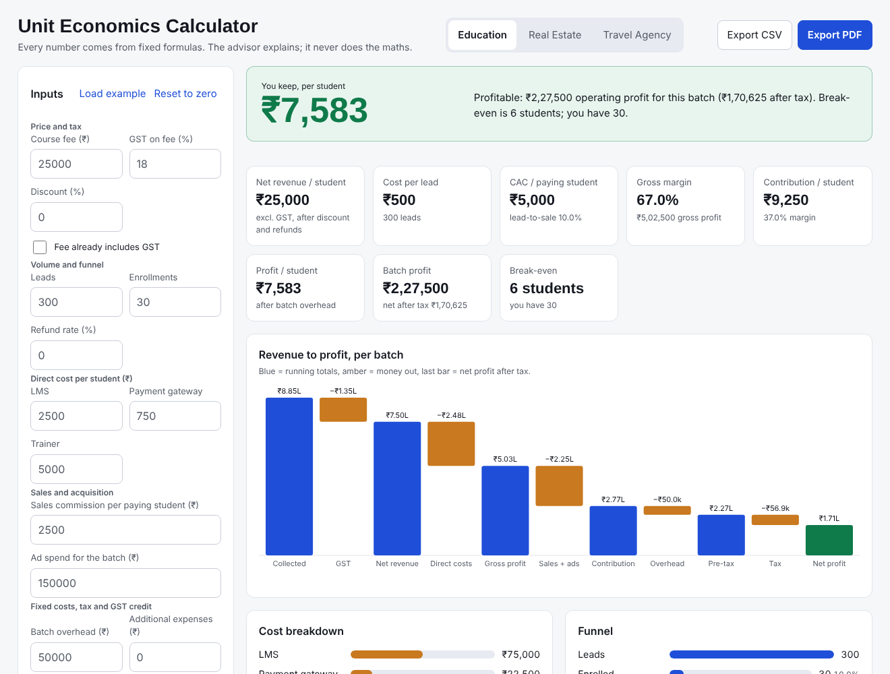
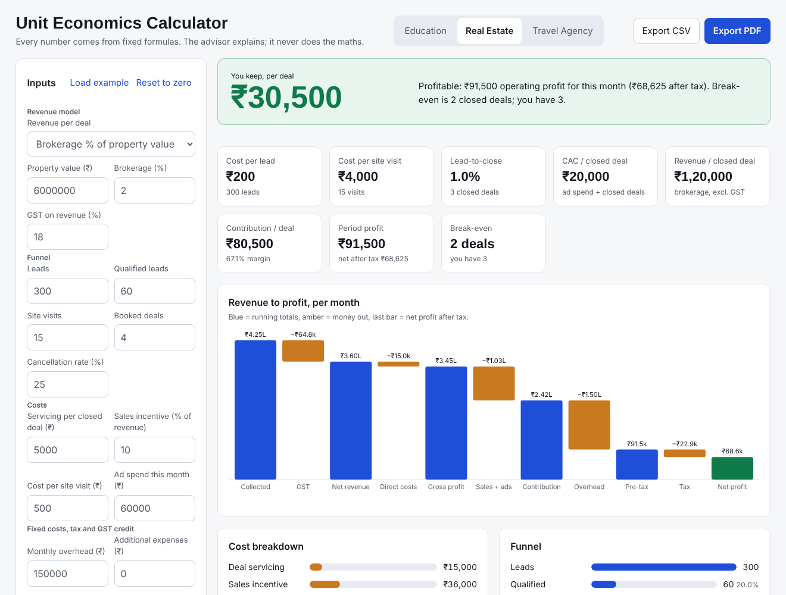
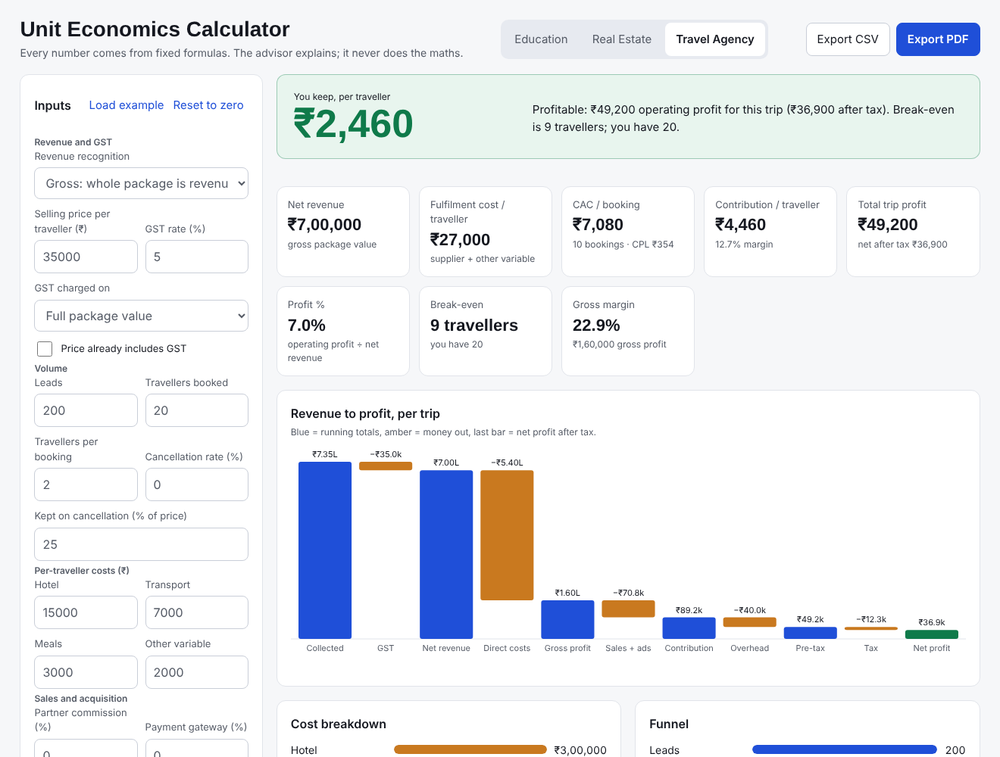
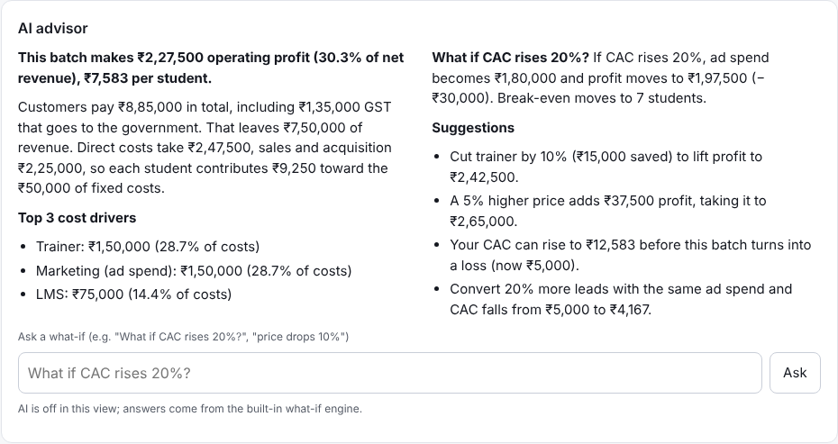
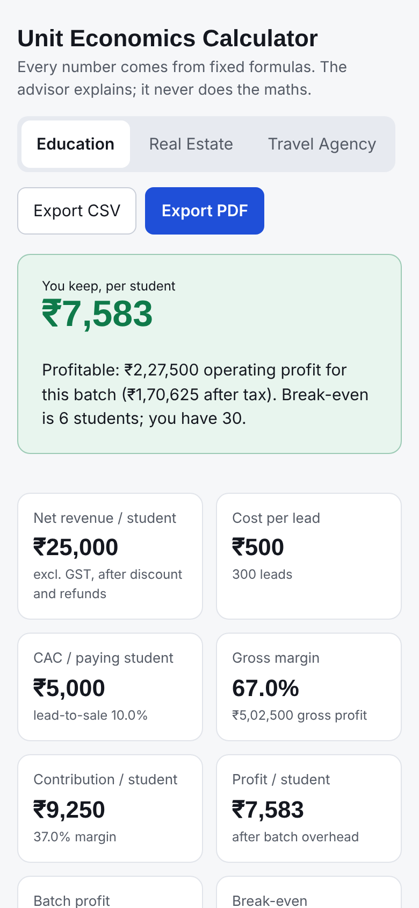

# Unit Economics Calculator

**Will this business make money?** A calculator for three business models (an online education course, real estate brokerage and a travel agency) that takes you from what the customer pays to the profit you keep. It shows CAC, contribution, break-even, scenarios, and an AI advisor that explains the numbers but never calculates them.

**Live demo:** https://axankit.github.io/unit-economics-calculator/



## Why I built it

This started as an assignment in the Performance Marketing Bootcamp by Umar Tazkeer. The first question a performance marketer should ask before running ads is: *how much can I spend to acquire one customer and still remain profitable?* This tool answers it for three very different businesses, using the same standard structure.

## Features

| Area | What it does |
| --- | --- |
| **Three industries** | Education (per student), Real Estate (per closed deal), Travel Agency (per traveller / booking), each with its own tab |
| **Editable inputs** | Price, volume, GST, discounts, refunds, cancellations, variable and fixed costs, funnel; **Load example** and **Reset** |
| **Verdict first** | "You keep ₹7,583 per student", in green or red, with operating profit, profit after tax and break-even |
| **KPI cards** | CPL, CAC, gross and contribution margin, profit per unit, period profit, break-even units |
| **Waterfall** | Collections → GST → net revenue → direct costs → gross profit → sales and ads → contribution → overhead → tax → net profit |
| **Alerts** | Losses, unreachable break-even, low margins, missing volume |
| **AI advisor** | Plain-language explanation, top 3 cost drivers, "What if CAC rises 20%?", and suggestions with real numbers |
| **Ask a what-if** | "What if price drops 10%?" is answered by the calculation engine; inside claude.ai, Claude words the answer using only pre-calculated numbers |
| **Scenarios** | Worst / base / best, plus your own saved scenarios, compared side by side |
| **Export** | CSV and PDF summary of the current tab |

## Screenshots

| Real estate | Travel agency |
| --- | --- |
|  |  |

| AI advisor | Mobile |
| --- | --- |
|  |  |

## How the maths works

Every industry follows the same ledger. Customer collections, revenue, taxes, variable costs, acquisition costs and fixed overhead are kept separate:

```
Customer collections
  − GST (and supplier pass-through for commission-only travel)
= Net revenue
  − Direct service / fulfilment costs
= Gross profit
  − Variable sales and acquisition costs (CAC)
= Contribution
  − Fixed period / batch overhead
= Operating profit
  − Additional expenses − estimated income tax
= Net profit

Break-even units = CEILING(fixed costs ÷ contribution per unit), only when contribution > 0
```

Full formulas and assumptions: [docs/FORMULAS.md](docs/FORMULAS.md) · Hand-worked checks: [docs/MANUAL-CHECKS.md](docs/MANUAL-CHECKS.md)

### Sample results (all verified by hand and by automated tests)

| Industry | Sample case | Operating profit | Break-even |
| --- | --- | --- | --- |
| Education | ₹25,000 course, 30 learners | ₹2,27,500 per batch | 6 students |
| Real Estate | 2% brokerage on ₹60 lakh, 3 closed deals | ₹91,500 per month | 2 deals |
| Travel Agency | ₹35,000 package, 20 travellers | ₹49,200 per trip | 9 travellers |

## Project structure

```
├── index.html              # page markup
├── css/styles.css          # styles (light and dark mode)
├── js/engine.js            # pure calculation engine: formulas only, no DOM
├── js/app.js               # UI: inputs, charts, advisor, scenarios, export
├── js/vendor/              # jsPDF (MIT) for PDF export
├── tests/engine.test.js    # checks the engine against the hand-worked samples
├── docs/                   # formulas, manual checks, screenshots
├── .github/workflows/      # CI tests + GitHub Pages deploy
└── netlify.toml            # optional Netlify deploy
```

The engine is kept separate from the UI on purpose: the maths can be tested on its own, and the AI layer can only read its results.

## Run it locally

No build step and no dependencies. Open `index.html` in a browser, or:

```bash
npm start   # serves the folder at http://localhost:3000
npm test    # runs the engine tests (Node 18+)
```

## Deploy

- **GitHub Pages (live):** every push to `main` runs the tests and publishes the site through `.github/workflows/pages.yml`.
- **Netlify (optional):** import this repo in Netlify; `netlify.toml` already sets the publish folder.

## Built with

HTML, CSS and vanilla JavaScript; jsPDF for PDF export; Node's built-in test runner. Designed and built with Claude, and every formula was checked by hand.

## Licence

MIT. See [LICENSE](LICENSE).
